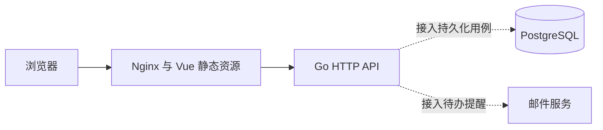

# 技术选型与架构

## 目标与约束

首版覆盖一个班的一次作业。组员需要在各自电脑上开发，并能用一台电脑完成局域网联调和答辩演示。业务重点是作业版本、评阅分配、匿名访问和修订追溯。

| 技术 | 选择依据与影响 |
| --- | --- |
| Go 1.25+ 与 net/http | 一个 API 服务负责接收请求、校验权限并执行业务规则。标准库提供路由和 HTTP 测试工具，骨架目前可直接构建与运行。随着用例落地，再按业务职责划分包。 |
| Vue 3、TypeScript、Vite | 问答、待评列表和修订对照需要交互与明确的加载状态。组件负责展示，TypeScript 约束接口数据，Vite 支持本地热更新和生产构建。 |
| PostgreSQL 17 | 作品版本、评阅任务和反馈关联适合用关系约束表达。互评分配与补派用事务维护一致性，具体表结构待需求评审。 |
| Docker Compose 与 Nginx | Compose 在本机启动 Web、API 与数据库。Nginx 提供同源访问，其余服务通过容器网络通信。 |
| 第三方邮件 | 第三个增量接入评阅及补派提醒。邮件只提示待办，站内保留任务状态。供应商和失败处理随设计评审确认。 |
| GitHub Actions | PR 上验证 Go、前端构建和 Compose 启动，检查首页、API 代理及数据库查询。 |

## 运行结构

当前启动页经 Nginx 访问 Go 的 `/healthz`。PostgreSQL 已随 Compose 启动，可独立验证查询。接入第一条持久化用例时加入驱动、连接配置和版本化迁移。组内共享环境由一台主机运行，开发成员日常使用各自的数据库卷。
