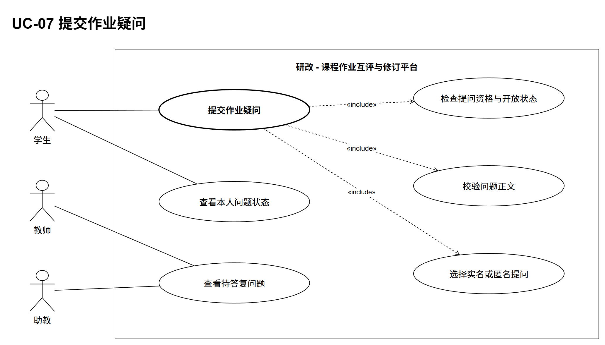
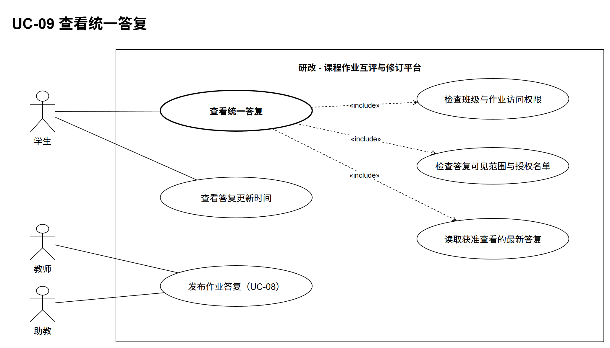
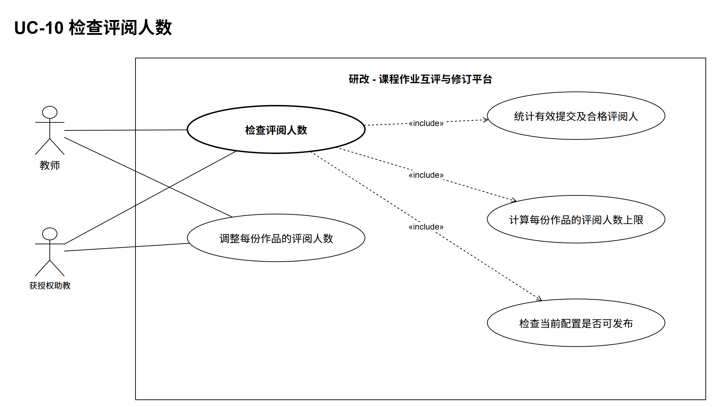
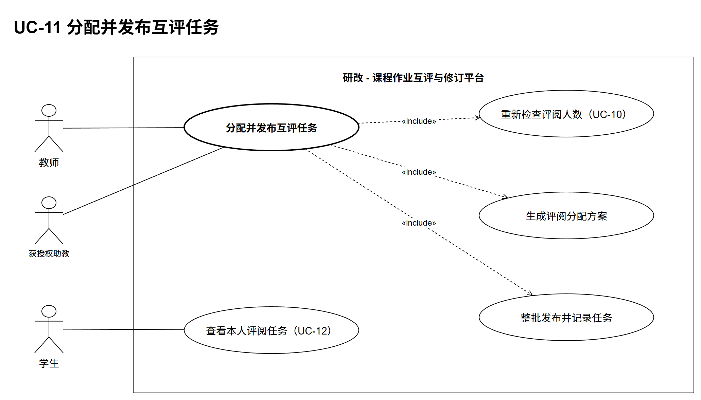
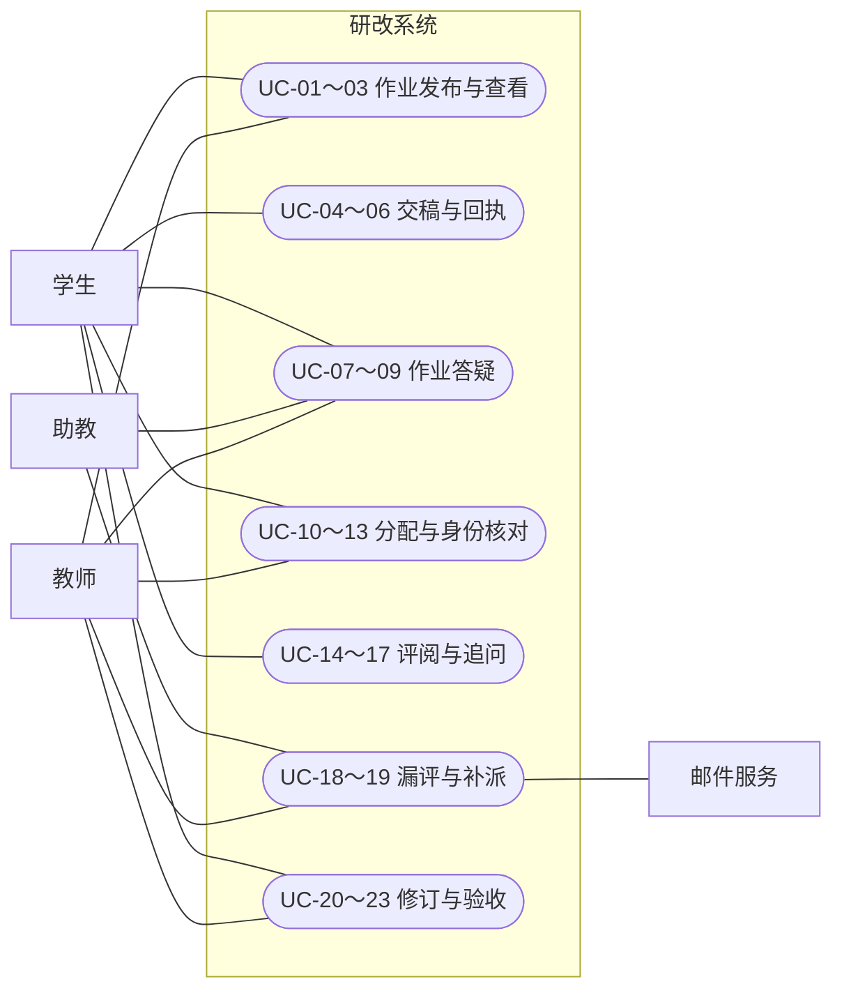

# 研改 - 软件需求规格说明书

| 项目 | 内容 |
| --- | --- |
| 版本 | v0.1 - 第 3 课评审稿 |
| 需求来源 | [R01–R10 用户故事汇总](../user-stories/user-stories-summary.md) |

## 1. 项目目的与范围

研改把课程作业答疑、匿名互评与修订对照组织成连续流程。学生能澄清具体意见并留下修改依据，教师能沿评语核对修订结果。首版按一个班的一次作业验收，依次交付作业与答疑、匿名互评与讨论、修订与管理三个增量。跨班协作、即时聊天及自动评分列入后续范围。

## 2. 参与者及接口

| 参与者 | 职责与访问范围 |
| --- | --- |
| 学生 | 查看本班发布的作业和统一答复，管理本人提交与修订。作为评阅人只读获分配的作品，作为作者只读本人收到的反馈。 |
| 教师 | 管理负责作业、评价维度与互评规则，处理异常，验收修订并核对身份。 |
| 助教 | 在授权作业中处理问答和补派。获教师授予互评管理权限后，可检查评阅人数、分配并发布任务；身份查询默认关闭。 |
| 邮件服务（次参与者） | 接收评阅待办通知请求并返回投递结果。通知包含登录入口和期限，正文及身份详情在站内按权限查看。 |

## 3. 业务规则与约束

- **提交版本**：以服务器时间判定截止，截止时封存最后一份有效提交。后续修订创建独立版本，评语继续指向封存稿。
- **互评资格**：有效提交者参与互评。教师设定每份所需评阅人数。若有 n 名符合资格的学生，每份作品最多分给 n−1 人。排除自评和重复分配，整体发布失败时不创建部分任务。
- **讨论与匿名**：获授权教学人员发布答复时可设置全班可见或指定人员可见。学生须同时具备作业访问权和该条答复的查看权限。私有讨论仅对作者、对应评阅人及授权教学人员开放。学生侧以匿名标识展示。教师身份查询留痕，助教身份查询需单独授权。
- **任务与补派**：评阅、反馈发布与讨论期限按作业设置。补派替换一个具体席位，原任务迟交单独挂起，经人工处理后方可计入且不得与替补结果重复计算。
- **格式与运行环境**：教师发布时声明允许格式。首版验收覆盖纯文本与 PDF，分别支持段落和页码定位，PDF 可并排查看。其他允许格式采用整篇评价。本机 Docker Compose 环境使用 Go、Vue、PostgreSQL，外部集成采用邮件。

- **作业要求与审计**：发布必填说明、格式、截止时间和评价维度。更正形成新版本，记录操作者、时间和摘要。互评引用的评价维度保持固定，保证同轮评阅口径一致。
- **提交有效性**：以系统保存成功的时间判定是否赶上截止。校验失败或上传中断保留此前有效版本，回执可核对编号、版本和时间。
- **教师验收**：反馈回应保存采纳状态和理由。删除原段时保留对原评语和初稿的引用，未采纳的意见交教师结合理由判断。

## 功能需求

| 编号 | 功能 | 系统要求 | 来源 |
| --- | --- | --- | --- |
| FR-01 | 发布作业 | 系统应支持教师发布作业。作业页显示全部字段、发布时间和版本号，发布人与内容留痕。缺必填项时逐项提示，草稿对学生不可见。 | R01 |
| FR-02 | 修订已发布作业要求 | 系统应支持教师修订已发布作业要求。学生看到最新版及更新时间，原版和修改记录可追溯。进入互评后禁止修改已被评阅任务引用的评价维度。 | R01 |
| FR-03 | 查看作业要求 | 系统应支持学生查看作业要求。显示当前说明、格式、截止时间、评价维度及版本。草稿或其他班级作业对该学生不可见。 | R01 |
| FR-04 | 首次提交作品 | 系统应支持学生首次提交作品。保存 V1，回执显示作业、提交编号、时间、文件名、版本及状态。文件校验失败时显示原因，状态仍为未提交。 | R02 |
| FR-05 | 替换已提交作品 | 系统应支持学生替换已提交作品。创建新版本和新回执，旧版本留存，新版本成为待封存版本。截止后拒绝替换，当前版本及时间保持原值。 | R02 |
| FR-06 | 核对提交回执 | 系统应支持学生核对提交回执。显示当前版本、提交时间、文件名、状态及评阅所用版本（封存后）。无有效提交时显示未提交，无回执。 | R02 |
| FR-07 | 提交作业疑问 | 系统应支持学生提交作业疑问。问题与该作业关联，作者可看到待答复状态，教师或助教可处理。空白正文不创建问题。 | R03-1 |
| FR-08 | 发布统一答复 | 系统应支持教师／助教发布统一答复。有权查看的学生看到最新有效答复与更新时间，提问者可在原问题查看答复。普通问题及答复默认仅提问者和授权教学人员可见，统一答复发布时不显示提问者标识。 | R03-1、R03-2 |
| FR-09 | 查看统一答复 | 系统应支持学生查看统一答复。显示对应问题、当前有效答复、更新时间和统一答复标记。尚无答复时显示空状态，可继续提问。 | R03-2 |
| FR-10 | 检查评阅人数 | 教师或获该作业互评管理权限的助教可以设置或调整每份作品的评阅人数，并重新检查。系统显示合格评阅人数、每份可分配上限与校验结果。人数不足时阻止发布。 | R04-2 |
| FR-11 | 分配并发布互评任务 | 系统应支持教师及获授权助教分配并发布互评任务。每份封存稿获得指定数量的不同评阅人，有效提交者的任务数量均衡，无自评。参数或候选名单发生变化时重新校验；失败时不发布部分任务。 | R04-1 |
| FR-12 | 查看本人评阅任务 | 系统应支持学生查看本人评阅任务。显示本人待评任务、状态、期限及所分配的匿名封存稿。没有任务时显示空状态；访问其他学生任务时拒绝。 | R04-1、R05 |
| FR-13 | 核对作品及评阅人身份 | 系统应支持教师核对作品及评阅人身份。可核对作者及评阅人，记录查询者与时间。助教默认只看进度，身份查询被拒绝。 | R05 |
| FR-14 | 提交评阅意见 | 系统应支持学生（评阅人）提交评阅意见。保存评论正文、维度、封存版本及定位信息。正文为空时提示并保留已填字段，未新增有效意见。 | R05、R06 |
| FR-15 | 按维度和位置查看反馈 | 系统应支持学生（作者）按维度和位置查看反馈。显示建议，定位到封存初稿；整篇反馈标记为整篇。已有修订稿时仍定位初稿，定位数据不可用时显示原文摘录与定位提示。 | R06 |
| FR-16 | 针对评语发起追问 | 系统应支持学生（作者）针对评语发起追问。问题出现在该讨论串，同一条意见的评阅人可见，学生端匿名。无访问权限或讨论已关闭时拒绝写入。 | R07 |
| FR-17 | 匿名回复评语追问 | 系统应支持学生（评阅人）匿名回复评语追问。作者在同一讨论串看到回复，学生端隐藏评阅人身份。其他评阅人无法回复。 | R07 |
| FR-18 | 查看漏评清单 | 系统应支持教师／助教查看漏评清单。显示每份作品已收有效评阅数量、目标数量以及未完成数。无漏评时显示空清单。 | R08 |
| FR-19 | 补派漏评任务 | 系统应支持教师／助教补派漏评任务。替补在任务列表看到补派标记；系统创建邮件待办提醒。没有合格替补时保持待处理；被替换者的迟交进入待处理且不计入有效数。 | R08 |
| FR-20 | 记录反馈处理及修改位置 | 系统应支持学生（作者）记录反馈处理及修改位置。处理状态、理由和位置与对应评语和修订版本关联。原段删除可填写原因并标记删除；暂不采纳可只写理由。 | R09 |
| FR-21 | 提交修订稿 | 系统应支持学生（作者）提交修订稿。形成独立修订版本，保留封存初稿和反馈链路。失败时保留现有有效版本；未回应意见可显示清单。 | R09、R10 |
| FR-22 | 按评语验收修订 | 系统应支持教师按评语验收修订。展示初稿位置、评语、可见讨论、回应理由和相关修改。未采纳意见展示理由供教师判断；删除段落显示删除说明。 | R10 |
| FR-23 | 查看作品版本差异 | 系统应支持教师查看作品版本差异。并排显示两个版本，受支持文本标出修改和删除。格式不支持差异时展示版本及可核对的修改定位。 | R10 |

## 4. 用例规约

责任人负责用例细化与验收核对。跨模块内容由主责人汇总，并与关联调研点负责人确认。

| 负责人 | 数量 | 用例 |
| --- | --- | --- |
| 赵睿妍 | 5 | UC-01、UC-02、UC-03、UC-04、UC-05 |
| 郭芷烟 | 4 | UC-07、UC-09、UC-10、UC-11 |
| 赵晨瑞 | 4 | UC-12、UC-13、UC-14、UC-15 |
| 张子原 | 5 | UC-08、UC-16、UC-17、UC-18、UC-19 |
| 于恩熙 | 5 | UC-06、UC-20、UC-21、UC-22、UC-23 |

### 4.1 发布作业

**UC-01** - 关联功能 **FR-01** - 负责人 **赵睿妍** - 来源 R01

- 主参与者为教师。
- 前置条件：班级和作业草稿已建立。
- 主流程：填写说明、交付格式、截止时间与评价维度，提交发布。
- 验收结果：作业页显示全部字段、发布时间和版本号，发布人与内容留痕。
- 异常或替代流程：缺必填项时逐项提示，草稿对学生不可见。

### 4.2 修订已发布作业要求

**UC-02** - 关联功能 **FR-02** - 负责人 **赵睿妍** - 来源 R01

- 主参与者为教师。
- 前置条件：作业已有发布版本。
- 主流程：修改允许变更的要求并填写变更摘要，再发布。
- 验收结果：学生看到最新版及更新时间，原版和修改记录可追溯。
- 异常或替代流程：进入互评后禁止修改已被评阅任务引用的评价维度。

### 4.3 查看作业要求

**UC-03** - 关联功能 **FR-03** - 负责人 **赵睿妍** - 来源 R01

- 主参与者为学生。
- 前置条件：学生已加入课程，作业已发布。
- 主流程：从课程列表打开作业。
- 验收结果：显示当前说明、格式、截止时间、评价维度及版本。
- 异常或替代流程：草稿或其他班级作业对该学生不可见。

### 4.4 首次提交作品

**UC-04** - 关联功能 **FR-04** - 负责人 **赵睿妍** - 来源 R02

- 主参与者为学生。
- 前置条件：作业已发布且未截止。
- 主流程：上传符合格式的文件并提交。
- 验收结果：保存 V1，回执显示作业、提交编号、时间、文件名、版本及状态。
- 异常或替代流程：文件校验失败时显示原因，状态仍为未提交。

### 4.5 替换已提交作品

**UC-05** - 关联功能 **FR-05** - 负责人 **赵睿妍** - 来源 R02

- 主参与者为学生。
- 前置条件：已有有效提交且未截止。
- 主流程：上传替换文件并确认。
- 验收结果：创建新版本和新回执，旧版本留存，新版本成为待封存版本。
- 异常或替代流程：截止后拒绝替换，当前版本及时间保持原值。

### 4.6 核对提交回执

**UC-06** - 关联功能 **FR-06** - 负责人 **于恩熙** - 来源 R02

- 主参与者为学生。
- 前置条件：学生已加入课程。
- 主流程：打开本人的提交详情。
- 验收结果：显示当前版本、提交时间、文件名、状态及评阅所用版本（封存后）。
- 异常或替代流程：无有效提交时显示未提交，无回执。

### 4.7 提交作业疑问

**UC-07** - 关联功能 **FR-07** - 负责人 **郭芷烟** - 来源 R03-1

- **参与者**：学生提交问题并查看本人问题状态。教师和具备该作业答疑权限的助教查看待答复问题。
- **前置条件**：学生属于该课程，有权访问作业，问答仍开放。
- **主流程**：学生在该作业问答区填写正文，选择实名或匿名并提交。系统检查课程成员资格、作业权限和问答开放状态，再校验正文。检查通过后，将问题及身份显示设置关联到该作业，状态设为「待答复」。
- **结果与权限**：学生可查看本人问题和处理状态。问题默认由提问者和授权教学人员查看。若原问题获准向同学公开，实名显示姓名，匿名显示「匿名提问」。UC-08 发布统一答复时隐藏提问者身份。
- **异常处理**：正文为空、问答关闭或学生无权提问时，系统拒绝提交，不创建问题。
- **验收**：分别实名、匿名提交有效问题。两次提交均出现在本人问题列表和授权教学人员的待答复列表中。原问题获准公开后，核对同学端的身份显示。再使用空白正文、关闭问答的作业和无课程资格的账号分别尝试提交，确认均未创建问题。

### 4.8 发布统一答复

**UC-08** - 关联功能 **FR-08** - 负责人 **张子原** - 来源 R03-1、R03-2

- 主参与者为教师／助教。
- 前置条件：教学人员有该作业的答疑权限。
- 主流程：打开学生问题，填写答复，设定全班或指定人员可见，并标记为统一答复。
- 验收结果：获准查看的学生能看到最新有效答复及更新时间。提问者可在原问题中查看对本人的答复。
- 异常或替代流程：普通问题及答复默认仅提问者和授权教学人员可见，统一答复发布时不显示提问者标识。

### 4.9 查看统一答复

**UC-09** - 关联功能 **FR-09** - 负责人 **郭芷烟** - 来源 R03-2

- **参与者**：学生。
- **前置条件**：作业已发布，学生有权访问该作业。
- **主流程**：学生打开问答区。系统检查班级成员资格与作业访问权，再逐条检查 UC-08 设置的可见范围。全班可见的答复面向有作业访问权的班级成员；指定人员可见的答复额外要求学生在授权名单内。系统读取符合条件的最新有效统一答复，学生可核对其更新时间。
- **结果**：显示对应问题、答复正文、更新时间和统一答复标记。答复不显示提问者身份。
- **异常处理**：无可见答复时显示空状态。通过直接链接访问时仍执行同样的权限检查，未授权时拒绝请求且不返回正文。
- **验收**：准备一条全班可见答复和一条指定学生可见答复。名单内学生能看到两条，名单外的同班学生只能看到前一条，即使直接访问后一条也无法读到正文。

### 4.10 检查评阅人数

**UC-10** - 关联功能 **FR-10** - 负责人 **郭芷烟** - 来源 R04-2

- **参与者**：教师或获该作业互评管理权限的助教。
- **前置条件**：提交截止且封存稿名单已确定。
- **主流程**：教师或授权助教发起检查，可先设置或调整每份作品的评阅人数。系统统计有效提交与合格评阅人，针对每份作品排除作者本人，计算可分配上限，再判断当前配置能否发布。
- **结果**：显示合格人数、每份可分配上限和校验结果。检查期间只更新配置与检查结果，正式任务由 UC-11 发布。
- **异常处理**：评阅量超过上限时提示原因并阻止发布。参与者可调整评阅量后重查。未授权人员不得修改配置。
- **验收**：只有两名学生有效提交时，由获授权助教把评阅人数设为两人，系统提示每份最多一人。调整为一人后检查通过，学生任务列表仍无新增任务。用未获授权的助教账号尝试修改配置，确认请求被拒绝且配置保持原值。

### 4.11 分配并发布互评任务

**UC-11** - 关联功能 **FR-11** - 负责人 **郭芷烟** - 来源 R04-1

- **参与者**：教师或获该作业互评管理权限的助教。学生通过 UC-12 查看已发布的本人任务。
- **前置条件**：交稿已截止，作品已封存，评阅人数和期限已配置。
- **主流程**：参与者确认发布。系统重新执行 UC-10 校验，按当前候选名单生成方案，排除自评、重复评阅和缺交学生，整批保存后发布。
- **结果**：系统记录这次分配和任务。每份封存稿获得指定数量的不同评阅人，各评阅人的任务数保持均衡。整批发布成功后，学生可通过 UC-12 查看本人获分配的封存版本、任务状态和评阅截止时间。
- **异常处理**：候选名单变化且当前配置不可行时提示重新调整。无权限、校验失败或写入失败时，整批保持未发布。重复提交发布请求仍只有一套有效任务。
- **验收**：四人有效提交且每份两评时，共发布八项任务，每份作品有两位不同评阅人，每位学生有两项待评任务且没有本人作品。重复发布同一轮时，任务数仍为八项。另用一轮未发布的作业模拟发布前只剩两名合格学生、仍要求每份两评，确认重新检查失败且学生端没有新增任务。

### 4.12 查看本人评阅任务

**UC-12** - 关联功能 **FR-12** - 负责人 **赵晨瑞** - 来源 R04-1、R05

- 主参与者为学生。
- 前置条件：教师已发布互评。
- 主流程：打开我的互评并选择一项任务。
- 验收结果：显示本人待评任务、状态、期限及所分配的匿名封存稿。
- 异常或替代流程：没有任务时显示空状态；访问其他学生任务时拒绝。

### 4.13 核对作品及评阅人身份

**UC-13** - 关联功能 **FR-13** - 负责人 **赵晨瑞** - 来源 R05

- 主参与者为教师。
- 前置条件：教师有本班身份审计权限。
- 主流程：查看指定作业的身份对应关系。
- 验收结果：可核对作者及评阅人，记录查询者与时间。
- 异常或替代流程：助教默认只看进度，身份查询被拒绝。

### 4.14 提交评阅意见

**UC-14** - 关联功能 **FR-14** - 负责人 **赵晨瑞** - 来源 R05、R06

- 主参与者为学生（评阅人）。
- 前置条件：评阅任务有效且意见可提交。
- 主流程：选择评价维度及原文位置或整篇范围，填写建议并提交。
- 验收结果：保存评论正文、维度、封存版本及定位信息。
- 异常或替代流程：正文为空时提示并保留已填字段，未新增有效意见。

### 4.15 按维度和位置查看反馈

**UC-15** - 关联功能 **FR-15** - 负责人 **赵晨瑞** - 来源 R06

- 主参与者为学生（作者）。
- 前置条件：本人的作品已有已发布反馈。
- 主流程：打开反馈、选择维度并定位原文。
- 验收结果：显示建议，定位到封存初稿；整篇反馈标记为整篇。
- 异常或替代流程：已有修订稿时仍定位初稿，定位数据不可用时显示原文摘录与定位提示。

### 4.16 针对评语发起追问

**UC-16** - 关联功能 **FR-16** - 负责人 **张子原** - 来源 R07

- 主参与者为学生（作者）。
- 前置条件：本人收到该条已发布反馈且讨论开放。
- 主流程：在对应评语下输入并发送问题。
- 验收结果：问题出现在该讨论串，同一条意见的评阅人可见，学生端匿名。
- 异常或替代流程：无访问权限或讨论已关闭时拒绝写入。

### 4.17 匿名回复评语追问

**UC-17** - 关联功能 **FR-17** - 负责人 **张子原** - 来源 R07

- 主参与者为学生（评阅人）。
- 前置条件：本人是对应评阅人且讨论开放。
- 主流程：打开评语讨论并提交回复。
- 验收结果：作者在同一讨论串看到回复，学生端隐藏评阅人身份。
- 异常或替代流程：其他评阅人无法回复。

### 4.18 查看漏评清单

**UC-18** - 关联功能 **FR-18** - 负责人 **张子原** - 来源 R08

- 主参与者为教师／助教。
- 前置条件：已有发布的互评任务。
- 主流程：打开管理页并筛选到期未完成的作品。
- 验收结果：显示每份作品已收有效评阅数量、目标数量以及未完成数。
- 异常或替代流程：无漏评时显示空清单。

### 4.19 补派漏评任务

**UC-19** - 关联功能 **FR-19** - 负责人 **张子原** - 来源 R08

- 主参与者为教师／助教。
- 前置条件：漏评已确认且有补派权限。
- 主流程：选择缺少的评阅席位，确认符合资格的替补。
- 验收结果：替补在任务列表看到补派标记；系统创建邮件待办提醒。
- 异常或替代流程：没有合格替补时保持待处理；被替换者的迟交进入待处理且不计入有效数。

### 4.20 记录反馈处理及修改位置

**UC-20** - 关联功能 **FR-20** - 负责人 **于恩熙** - 来源 R09

- 主参与者为学生（作者）。
- 前置条件：作品进入修订阶段且反馈已发布。
- 主流程：标记采纳、部分采纳或暂不采纳，填写理由并按情况关联修改位置。
- 验收结果：处理状态、理由和位置与对应评语和修订版本关联。
- 异常或替代流程：原段删除可填写原因并标记删除；暂不采纳可只写理由。

### 4.21 提交修订稿

**UC-21** - 关联功能 **FR-21** - 负责人 **于恩熙** - 来源 R09、R10

- 主参与者为学生（作者）。
- 前置条件：修订窗口开放。
- 主流程：上传新版、检查已记录的回应并提交。
- 验收结果：形成独立修订版本，保留封存初稿和反馈链路。
- 异常或替代流程：失败时保留现有有效版本；未回应意见可显示清单。

### 4.22 按评语验收修订

**UC-22** - 关联功能 **FR-22** - 负责人 **于恩熙** - 来源 R10

- 主参与者为教师。
- 前置条件：教师有该作业权限且学生已交修订稿。
- 主流程：打开修订详情并选择一条评语。
- 验收结果：展示初稿位置、评语、可见讨论、回应理由和相关修改。
- 异常或替代流程：未采纳意见展示理由供教师判断；删除段落显示删除说明。

### 4.23 查看作品版本差异

**UC-23** - 关联功能 **FR-23** - 负责人 **于恩熙** - 来源 R10

- 主参与者为教师。
- 前置条件：初稿和修订稿皆存在。
- 主流程：打开版本对照。
- 验收结果：并排显示两个版本，受支持文本标出修改和删除。
- 异常或替代流程：格式不支持差异时展示版本及可核对的修改定位。

### 4.24 用例图

## 5. 非功能需求与验收用例

| 需求与验收用例 | 类别 | 来源 | 验收通过条件 |
| --- | --- | --- | --- |
| NFR-01／NFC-01 | 匿名保护 | R05、R07 | 使用带实名、学号和账号标识的测试账户完成评阅与讨论。学生页面、API 字段、系统生成的下载名和通知均不得暴露对方身份。提交前提醒作者检查文件内署名。 |
| NFR-02／NFC-02 | 访问控制 | R05、R07 | 无关同班学生及其他班学生直接请求私有讨论、反馈和作品时，返回拒绝或不存在，响应不含正文或参与者身份。未授予身份查询权限的助教请求身份接口也应被拒绝。 |
| NFR-03／NFC-03 | 一致性 | R02、R04-1、R08 | 同时发布两次仅生成一套任务。并发补派与迟交后每个席位至多计入一份有效反馈。截止后的重试不改变封存版本。 |
| NFR-04／NFC-04 | 性能 | R03-2、R04-1、R06 | 本机 Compose 预置 50 名学生及每人两项任务，10 个并发会话分别访问作业、评阅列表和反馈详情，每入口至少 100 次。各入口记录请求总数、失败数及 P95，要求无失败且 P95 不超过 2 秒。记录测试主机配置，文件下载另计。 |
| NFR-05／NFC-05 | 可用性 | R02、R04-2 | 至少三名试用者分别验证提交回执和评阅人数不足提示。均能确认有效版本、可分配上限，并独立完成配置修正。 |
| NFR-06／NFC-06 | 通知可靠性 | R08 | 邮件服务超时时，已补派任务在站内仍可见，保留投递失败记录并可重试，重复投递不重复创建任务。 |

## 6. 需求追溯矩阵

| 调研／故事 | 功能需求 ↔ 用例 | 非功能需求 ↔ 验收用例 |
| --- | --- | --- |
| R01 | FR-01 ↔ UC-01、FR-02 ↔ UC-02、FR-03 ↔ UC-03 | - |
| R02 | FR-04 ↔ UC-04、FR-05 ↔ UC-05、FR-06 ↔ UC-06 | NFR-03 ↔ NFC-03、NFR-05 ↔ NFC-05、NFR-07 ↔ NFC-07 |
| R03-1 | FR-07 ↔ UC-07、FR-08 ↔ UC-08 | - |
| R03-2 | FR-08 ↔ UC-08、FR-09 ↔ UC-09 | NFR-04 ↔ NFC-04 |
| R04-1 | FR-11 ↔ UC-11、FR-12 ↔ UC-12 | NFR-03 ↔ NFC-03、NFR-04 ↔ NFC-04 |
| R04-2 | FR-10 ↔ UC-10 | NFR-05 ↔ NFC-05 |
| R05 | FR-12 ↔ UC-12、FR-13 ↔ UC-13、FR-14 ↔ UC-14 | NFR-01 ↔ NFC-01、NFR-02 ↔ NFC-02 |
| R06 | FR-14 ↔ UC-14、FR-15 ↔ UC-15 | NFR-04 ↔ NFC-04 |
| R07 | FR-16 ↔ UC-16、FR-17 ↔ UC-17 | NFR-01 ↔ NFC-01、NFR-02 ↔ NFC-02 |
| R08 | FR-18 ↔ UC-18、FR-19 ↔ UC-19 | NFR-03 ↔ NFC-03、NFR-06 ↔ NFC-06 |
| R09 | FR-20 ↔ UC-20、FR-21 ↔ UC-21 | NFR-07 ↔ NFC-07 |
| R10 | FR-21 ↔ UC-21、FR-22 ↔ UC-22、FR-23 ↔ UC-23 | NFR-07 ↔ NFC-07 |

[评审进度与需求变更记录](../delivery/srs-progress.md)
